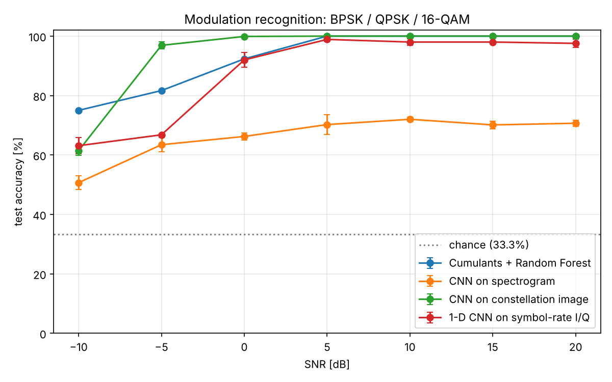
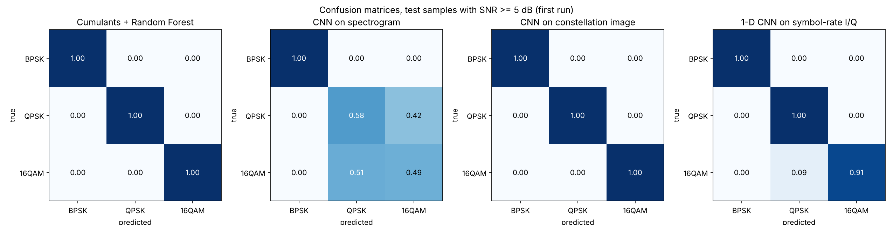
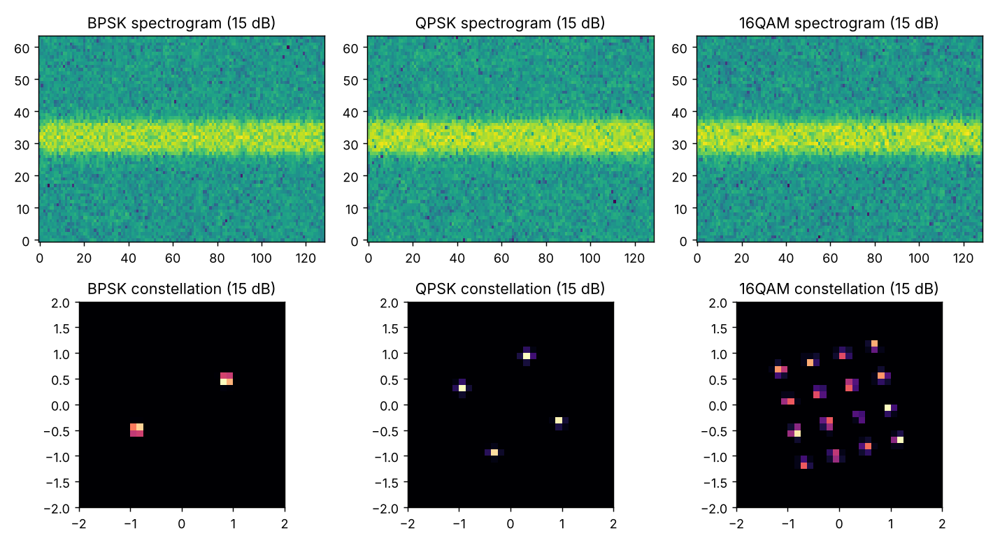

# Modulation Recognition: Which Input Representation Works Best?

[](../../actions)

Automatic modulation recognition (AMR) classifies a received radio signal as **BPSK, QPSK or 16-QAM** without being
told which was sent. This project simulates the full baseband chain and **compares four ways of presenting the signal
to a classifier**, in PyTorch / scikit-learn, with accuracy measured across SNR from -10 to 20 dB.

The headline finding is a negative one for the popular "CNN on spectrograms" idea: **a spectrogram is a poor input for this particular
3-class problem**, while a constellation image or classical higher-order cumulants work far better.

## Results (fresh test set, 2100 signals = 100 per class per SNR; CNNs averaged over 3 training seeds)

| Input representation / model | Overall accuracy | Accuracy at SNR >= 5 dB |
|---|---|---|
| Spectrogram -> 2-D CNN | 66.2 % +/- 1.3 | 70.8 % +/- 1.1 |
| Symbol-rate I/Q sequence -> 1-D CNN | 87.8 % +/- 1.0 | 98.1 % +/- 0.8 |
| **Constellation image -> 2-D CNN** | **94.0 % +/- 0.2** | **100.0 %** |
| Cumulants (|C20|, |C40|, C42) -> Random Forest | 92.7 % (1 run, deterministic) | 100.0 % |

Accuracy by SNR [%]:

| SNR (dB) | -10 | -5 | 0 | 5 | 10 | 15 | 20 |
|---|---|---|---|---|---|---|---|
| Spectrogram CNN | 51 | 63 | 66 | 70 | 72 | 70 | 71 |
| I/Q 1-D CNN | 63 | 67 | 92 | 99 | 98 | 98 | 98 |
| Constellation CNN | 61 | 97 | 100 | 100 | 100 | 100 | 100 |
| Cumulants + RF | **75** | 82 | 92 | 100 | 100 | 100 | 100 |



What the data say:
* **Spectrogram CNN plateaus near 70 % even at 20 dB.** Its confusion matrix shows BPSK is identified perfectly but QPSK and 16-QAM
  are close to a coin flip. This is consistent with theory: with the same pulse shaping and symbol rate, these modulations have
  nearly identical power spectra, so the information that separates them (amplitude/phase structure) is mostly discarded by a
  magnitude spectrogram. (I did not run a dedicated ablation to prove the mechanism.)
* **Constellation CNN is best from -5 dB upward**, but **at -10 dB the classical cumulant + Random Forest baseline wins** (75 % vs 61 %).
  A simple, well-chosen feature set is hard to beat in the noisiest regime.
* Cumulant features were checked against closed-form theory in the unit tests (e.g. QPSK |C40| = 1, 16-QAM = 0.68).




## Simulation setup
* 512 symbols/frame, 8 samples/symbol, root-raised-cosine pulse shaping (roll-off 0.35), AWGN, **random carrier phase**.
* SNR = signal power / noise power over the whole sampled band (wideband SNR).
* Train / validation / test sets are generated with **different random seeds** (4200 / 630 / 2100 signals), balanced over class and SNR.
  All four representations are computed from the *same* noisy realisation.
* Spectrogram: 64-point STFT (50 % overlap), log-power, standardised.
  Constellation: 32x32 histogram of matched-filter outputs at symbol instants.
  I/Q: those same symbol-rate samples as a 2 x 512 sequence.
* Models: 3-block CNNs with batch-norm and dropout, Adam + cosine schedule, 12 epochs, best epoch chosen on the validation set only.

## Limitations (important)
* **Simulation only**: AWGN channel, no fading, no multipath, no hardware impairments, no frequency offset. Results
  would be lower on real captured signals.
* **Constellation and I/Q inputs assume ideal symbol timing** (a perfect timing recovery stage). The spectrogram does not need it, which is a real
  advantage of that representation that this benchmark does not credit.
* Only 3 modulation classes; more classes (e.g. 8-PSK, 64-QAM, FSK) would change the ranking, especially for spectrograms, since
  FSK/AM/FM *do* differ in spectrum.
* CNN std is over 3 seeds, and a single data realisation; with 100 test signals per class per SNR, each per-SNR cell has roughly +/- 3 % sampling noise.
* The CNN is small and lightly tuned; I make no state-of-the-art claim.

## Reproduce
```bash
pip install -r requirements.txt
pytest -q                          # 13 tests
python run_experiments.py          # full run, ~17 min on 1 CPU core (the spectrogram CNN dominates)
python run_experiments.py --n-train 20 --n-val 5 --n-test 10 --epochs 2 --seeds 1   # ~20 s smoke run
```

## Layout
```
src/amr/signals.py     RRC filter, constellations, channel, matched filter
src/amr/features.py    spectrogram, constellation image, I/Q, cumulants
src/amr/dataset.py     builds all representations from the same realisations
src/amr/models.py      2-D and 1-D CNNs
src/amr/train.py       training loop (best-on-validation)
run_experiments.py     produces results/ (json + figures)
```

## License
MIT
